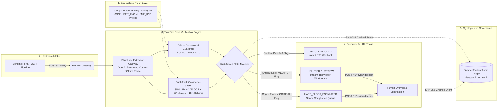

# System Architecture & Technical Specification: TrustOps v1.0

## 1. End-to-End Platform Topology

TrustOps decouples **YAML-driven policy configuration** from the **stateless verification pipeline** and **cryptographic audit ledger**.

---

## 2. Module Boundaries & Responsibilities

| Layer | File Path | Architectural Role |
| :--- | :--- | :--- |
| **Policy Configuration** | `configs/fintech_lending_policy.yaml` | Externalizes confidence weights, track-specific thresholds (`0.90` vs `0.93`), SLA targets, sancion lists, and unit-cost assumptions. |
| **Data Contracts** | `src/schemas.py` | Defines strict Pydantic v2 models for dual-track intake, extracted profiles, UBO arrays, policy flags, and audit records. |
| **Extraction Gateway** | `src/extractor.py` | Supports live `gpt-4o-mini` Structured Outputs (`TRUSTOPS_LIVE_LLM=1`) and a deterministic zero-key parser for reproducible CI/CD runs. |
| **Guardrail & State Machine** | `src/guardrails.py` | Evaluates rules `POL-001` through `POL-010`, computes the weighted confidence score, and assigns the routing tier and SLA timer. |
| **Cryptographic Audit** | `src/audit.py` | Append-only JSON-L logger chaining each event via SHA-256 (`prev_hash` $\rightarrow$ `event_hash`) with full chain verification (`verify_chain_integrity()`). |
| **Pipeline Orchestrator** | `src/pipeline.py` | Coordinates verification execution, manages in-memory HITL queues, and commits operator overrides. |
| **REST Microservice** | `src/main.py` | FastAPI service exposing `/v1/verify`, `/v1/review-queue`, `/v1/review/{case_id}/decision`, `/v1/audit-trail/{case_id}`, `/v1/config`, `/v1/metrics`, and `/health`. |
| **Reviewer Workbench** | `ui/app.py` | 4-tab Streamlit operational console for live intake simulation, HITL triage, SHA-256 ledger inspection, and benchmark telemetry. |

---

## 3. Tamper-Evident SHA-256 Audit Chain Specification

To satisfy **SOC 2 Type II** and **ISO/IEC 27001** non-repudiation controls, every event $i$ computes its cryptographic digest over canonical sorted JSON:

$$H_i = \text{SHA256}\left(\text{CanonicalJSON}(\text{event\_id}_i, \text{timestamp}_i, \text{case\_id}_i, \text{workflow\_type}_i, \text{actor}_i, \text{decision}_i, \text{payload}_i, H_{i-1})\right)$$

where $H_0 = \text{"0"}^{64}$ is the genesis hash. Any unauthorized database modification of a historical decision, confidence score, or reviewer note invalidates $H_i$ and breaks the chain link for $H_{i+1}$, immediately alerting platform monitors on `GET /health`.
